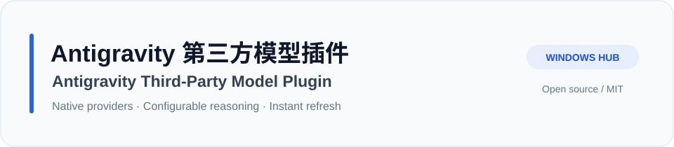
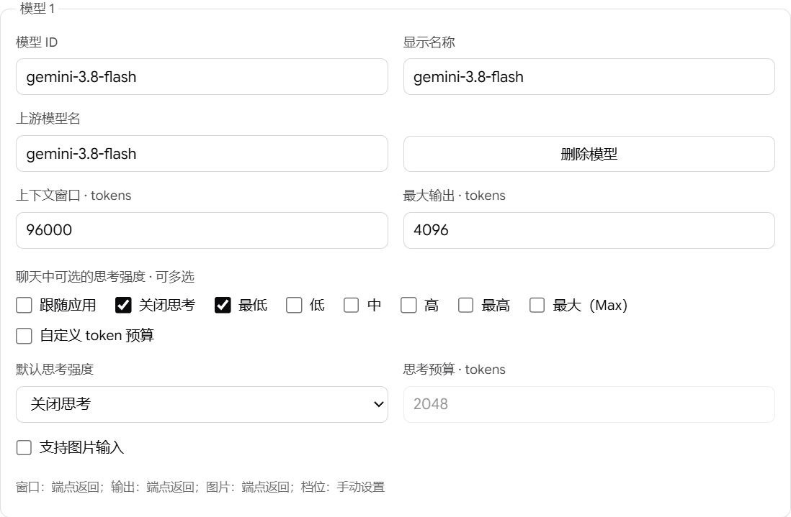
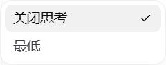
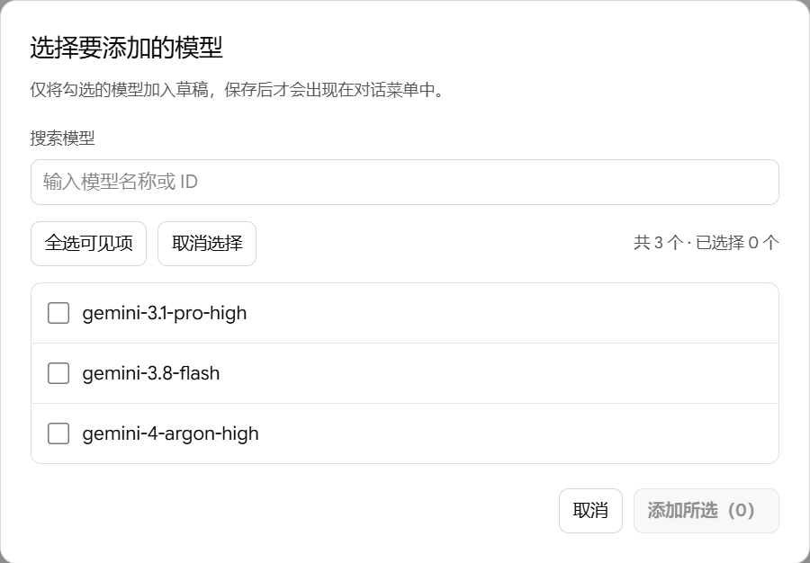
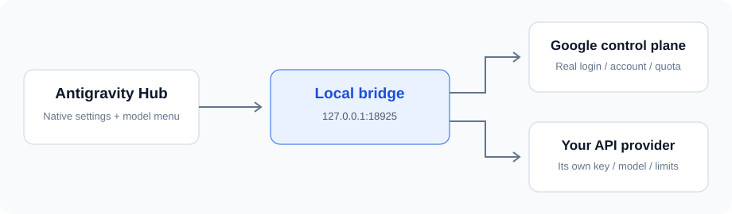

<div align="center">
  

  <p><strong>把第三方模型接入 Antigravity，操作留在原生界面里。</strong></p>
  <p>提供商设置 · 自选思考档位 · 模型配置发现 · 保存即刷新</p>

  <p>
    <a href="https://github.com/ldxm666/antigravity-third-party-model-plugin/releases"></a>
    <a href="#开发与验证"></a>
    
    
    <a href="LICENSE"></a>
  </p>

  <p><a href="#快速开始">快速开始</a> · <a href="docs/QUICKSTART.md">完整教程</a> · <a href="docs/TROUBLESHOOTING.md">问题排查</a> · <a href="docs/README.en.md">English</a></p>
</div>

> [!IMPORTANT]
> 这是独立社区项目，当前针对 **Windows x64 · Antigravity Hub 2.31.2** 验证。需要正常的 Google 登录与网络连接，以及你有权使用的提供商 API。项目不伪造账号、套餐或额度，也不提供登录绕过。应用更新可能需要重新适配。

## 为什么做这个

配置第三方模型，不应该在聊天、外部网页和独立悬浮窗之间来回切换。Antigravity 第三方模型插件（Antigravity Third-Party Model Plugin）把提供商管理放进原有设置页，把推理强度放进原生模型菜单；后台负责协议转换、模型身份隔离与参数限制。

| 你要做的事 | 在这里完成 |
|---|---|
| 添加 OpenAI 兼容、Anthropic 或 Gemini 提供商 | **设置 → 模型提供商** |
| 拉取模型后只加入想用的几项 | **获取可用模型 → 搜索 / 勾选 → 添加所选** |
| 只开放“关闭思考”和“最低”，或选择其他组合 | 每个模型的 **可用思考强度多选** |
| 在当前聊天切换强度 | 原生模型选择器的 **二级菜单** |
| 查询上下文、输出、图片与思考能力 | **自动配置所有模型**，检查来源后保存 |
| 添加、删除或调整模型 | **保存后热刷新**，日常修改无需重启应用 |

## 看看实际效果

### 01 · 设置中多选，聊天中按需显示



上图仅勾选“关闭思考”和“最低”，原生聊天子菜单就只显示这两项：



可配置：跟随应用、关闭思考、最低、低、中、高、最高、Max、自定义 token 预算。**这些是可配置选项，不代表每个上游都支持全部档位。** 默认值也必须来自已选集合。自定义预算会按所选协议转换。

### 02 · 先选择模型，再保存



获取列表不会直接把所有模型塞进菜单。新增项默认不选，已有项会标记；“添加所选”只修改草稿，**保存**后才生效。取消不改变已有草稿。

### 03 · 自动配置，有来源可查

点击“**自动配置所有模型**”，为当前列表中的模型查询配置：

1. 优先采用提供商的 **单模型详情**。
2. 其次采用 **模型列表元数据**。
3. 缺失项按保守的 **已知模型能力表**补齐。
4. 未识别的字段 **保留原值**，并显示状态。

支持上下文上限、最大输出、图片输入和思考档位。只发出只读模型查询，不发送测试聊天，不自动加入未选择的模型，也不自动保存。端点不提供信息时不会冒充“获取成功”。

## 快速开始

### 1. 下载一键包

从 [Releases](https://github.com/ldxm666/antigravity-third-party-model-plugin/releases/latest) 下载 **`antigravity-third-party-model-plugin-v1.5.2-windows-x64.zip`**，完整解压到普通目录。不要在 ZIP 预览中直接运行。

可选校验：将 ZIP 与同版本 `SHA256SUMS.txt` 放在一起，在 PowerShell 执行：

```powershell
Get-FileHash .\antigravity-third-party-model-plugin-v1.5.2-windows-x64.zip -Algorithm SHA256
```

### 2. 双击安装

运行 **`install-oneclick.cmd`**。

- 检测 Node.js 24.5+；没有合适版本时下载官方固定版本并校验 SHA-256。
- 安装到 `%LOCALAPPDATA%\Programs\agy-bridge`，配置隐藏自启与诊断入口。
- 备份并更新本机 Antigravity 接入文件，保留已有提供商配置。
- 首次接入后，从托盘完全退出 Antigravity，再正常打开 **一次**。

首次安装需要联网访问 Node.js/npm。安装器不自带 Antigravity，不会自动结束它的进程，也不会自动导入任何 API Key。自定义应用路径见 [完整教程](docs/QUICKSTART.md)。

### 3. 添加自己的提供商

进入 **设置 → 模型提供商 → 添加提供商**，填写协议、地址和密钥。

**获取可用模型 → 勾选 → 添加所选 → 自动配置所有模型 → 检查档位与容量 → 保存。**

之后在聊天模型菜单选模型和强度即可。相同模型名带提供商后缀，内部也按提供商隔离，避免路由串线。已有密钥输入框留空保存会保留原值。

## 协议与边界

| 接口 | 已实现的推理形式 | 说明 |
|---|---|---|
| OpenAI 兼容 | Chat Completions | 非流式、SSE、工具调用与 reasoning 内容转换；不是 Responses API 适配器 |
| Anthropic | Messages | 文本、工具、thinking；按模型区分预算与自适应思考 |
| Gemini | GenerateContent | 流式与非流式、工具、图片与 thinking 参数 |

上下文按文本估算，超过本地配置限制会报错；输出按请求值、模型最大输出和剩余上下文取较小值。**填写更大的容量不会扩大上游模型能力。** 代理站对参数的支持可能不同，应以其实际响应为准。

**最大输出必须严格小于上下文窗口**，为输入、历史消息和智能体指令保留空间。两者填成相同值会导致原生智能体在发送请求前终止；v1.5.3 在界面和保存 API 中均会拦截。自动配置遇到矛盾的端点容量会保留原始值并提示，需核对后再保存。

## 它如何工作



只把 LS 的 `cloud_code_endpoint` 接到 `127.0.0.1:18925`；`api_server_url` 保持 Google 原址。原生设置通过受限 IPC 访问本地配置，模型目录通过真实 Google 响应扩展。详情见 [架构说明](docs/ARCHITECTURE.md)。

## 隐私、升级与回滚

- 提供商密钥在本机配置中 **明文保存**；不要把配置文件上传到仓库或 issue。
- **v1.5.1 默认关闭原始请求抓取**。只有显式开启 `capture_requests` 才保存诊断请求正文。
- 应用升级可能覆盖补丁，重新接入前先检查兼容性；首次主进程接入需重启一次，普通模型修改无需重启。
- 运行安装目录中的 **`uninstall-keep-config.cmd`** 可回滚并保留配置；详见教程。不要把旧版本 asar 备份盲目恢复到另一个应用版本。

了解更多：[安全说明](SECURITY.md) · [问题排查](docs/TROUBLESHOOTING.md) · [更新记录](CHANGELOG.md)

## 开发与验证

```powershell
npm ci
npm test
npm run test:installer   # Windows：独立临时 asar，不修改真实应用
npm run build:release    # 生成 ZIP 与 SHA256SUMS.txt
```

v1.5.3 本地通过 38 项单元 / HTTP 集成检查、156 项协议检查和 39 项新配置回归，安装器隔离测试另行通过。测试覆盖模型集合、非标准思考档位、配置迁移、容量约束、端点优先级、草稿不落盘、密钥保留、Google 控制面错误及生成超时，不需要真实账号或提供商密钥。

真实桌面界面也做过多选保存、原生菜单和自动配置验证；截图中的容量来自受控示例端点，并不代表模型的官方规格。仓库附有 [可选 GitHub Actions 模板](docs/ci/README.md)，当前未启用远程 CI；不会把本地测试标成远程运行成功。

## 参与与致谢

欢迎带着复现步骤和脱敏信息提交 [Issue](https://github.com/ldxm666/antigravity-third-party-model-plugin/issues)，或阅读 [贡献指南](CONTRIBUTING.md) 后提交改进。请勿上传账号文件、密钥、完整聊天抓包或应用二进制。

本地协议桥思路参考 [Cute-chen/agy-bridge](https://github.com/Cute-chen/agy-bridge)。本项目针对 Windows Hub 扩展原生页面、真实控制面透传与可配置档位。第三方说明见 [THIRD_PARTY_NOTICES.md](THIRD_PARTY_NOTICES.md)。

**MIT License** · 独立社区项目 · 与 Google / Antigravity 官方无隶属关系。
