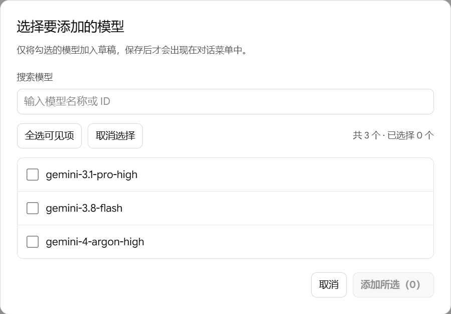
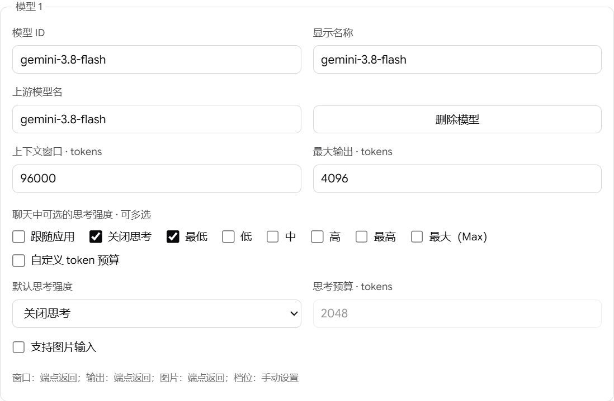

# 从下载到第一条消息

[返回 README](../README.md)

## 运行条件

- Windows x64，当前验证的应用为 Antigravity Hub 2.31.2。
- 已安装并正常登录 Antigravity，Google 网络连接正常。
- 自己有权使用的第三方 API 地址、密钥和模型。
- 首次安装可访问 Node.js 官方源与 npm。缺少 Node 时安装器使用固定的 24.15.0 Windows x64 发行包，SHA-256 固定在脚本中。

## 一键安装

1. 下载 Release ZIP 和校验文件，完整解压。
2. 可选：用 `Get-FileHash` 对照 `SHA256SUMS.txt`。
3. 双击 `install-oneclick.cmd`，等待安装完成。
4. 首次接入后，从应用托盘菜单完全退出，再使用正常快捷方式打开一次。

默认安装目录：`%LOCALAPPDATA%\Programs\agy-bridge`。数据目录：`%LOCALAPPDATA%\agy-bridge`。解压目录可以与安装目录不同，安装器会复制运行文件；不需要把文件放到系统目录。

自定义 Antigravity 路径：

```powershell
powershell -NoProfile -ExecutionPolicy Bypass -File .\install\oneclick.ps1 `
  -AsarPath "D:\Apps\Antigravity\resources\app.asar"
```

先预览计划、不执行安装：

```powershell
powershell -NoProfile -ExecutionPolicy Bypass -File .\install\oneclick.ps1 -DryRun
```

如果已有另一个目录启动的桥，安装器会保留正在运行的进程，不强制接管它。迁移目录时，先用旧目录的卸载入口保留配置，再安装新包；原地升级则在升级后运行同目录 `restart-bridge.cmd`。第三方提供商和模型配置会保留。

## 添加与选择模型

1. 打开 **设置 → 模型提供商**，点击 **添加提供商**。
2. 填写名称、协议、API 地址和密钥。密钥不需要发给任何人。
3. 可以先点 **测试连接**；未保存的表单也可以测试。
4. 点 **获取可用模型**，在二级窗口搜索并勾选需要的模型。
5. 点 **添加所选**。只把勾选项加入草稿；取消不改变草稿。
6. 检查模型 ID、上游模型名和显示名称。



若列表接口不受支持，可手动添加模型。模型 ID 用于本地识别，上游模型名是实际发送给提供商的值。

## 配置容量、图片与思考

点击 **自动配置所有模型**，查看每个模型下方的来源提示。

| 来源 | 含义 |
|---|---|
| 端点返回 | 来自当前提供商的模型详情或列表 |
| 能力表 | 端点缺失，按已知模型名称补齐；代理站实现可能不同 |
| 保留原值 / 未识别 | 没有可靠信息，仍需自行核对 |
| 手动设置 | 当前值来自你的调整 |

上下文窗口和最大输出单位为 tokens，可写 `128K`、`1M` 或整数。图片支持可以手动勾选。每个模型的思考档位是多选，聊天菜单只显示这些勾选项；默认值从集合中选择。勾选自定义预算后填写有效预算。



配置完成点击 **保存**。原生模型菜单会刷新，当前会话和输入框保持挂载。新增、删除或改档位均不需要重启应用。

## 聊天与默认路由

在聊天底部展开模型选择器，选择“模型 · 提供商”，再选择其二级思考档位。聊天中的明确选择优先于该模型默认值。

“设为默认提供商 / 更新默认模型”用于未明确指定模型的默认路由。配置了相同模型名的多个提供商仍有独立内部 ID。

示例文件仅作字段参考：

- [OpenAI 兼容模板](../examples/openai-compatible.example.json)：替换域名、模型名和密钥。
- [Gemini 模板](../examples/gemini.example.json)：参数仍应按自己账户和端点实际支持核对。

请在应用界面填入真实密钥；不要把示例替换为真实密钥后提交到 Git。

## 重启桥与回滚

后台代码升级时可运行安装目录里的 `restart-bridge.cmd`，它只终止与该目录匹配的 Node 桥，遇到其他程序占用端口会拒绝停止。应用本身保持运行。日常保存模型不需要这一步。

回滚并保留配置：双击 `uninstall-keep-config.cmd`。自定义应用路径用户请先用 `node patch/restore.mjs --asar "自定义路径\app.asar"` 还原，再运行卸载脚本。

回滚后的 asar 在应用下次正常启动时加载。不要在应用更新后把过期备份覆盖到新版本；先确认备份属于当前版本。
