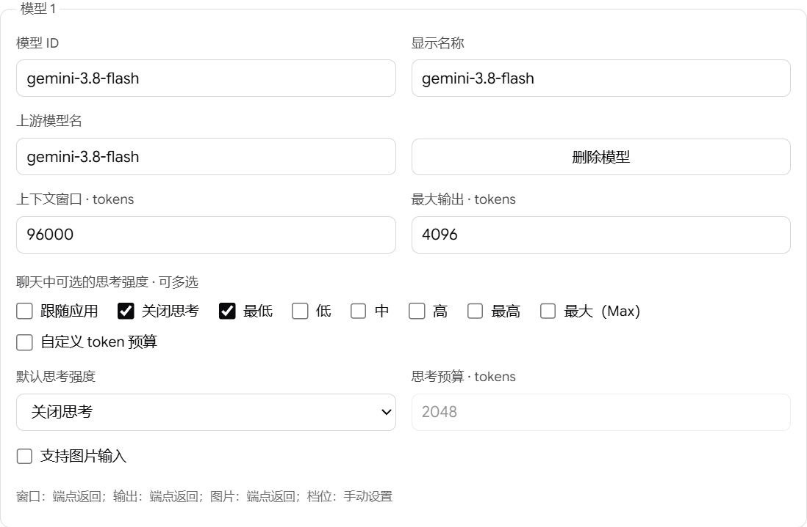

# Antigravity Third-Party Model Plugin

**Antigravity 第三方模型插件**

[中文](../README.md) · [Releases](https://github.com/ldxm666/antigravity-third-party-model-plugin/releases)

Native third-party provider settings and configurable reasoning menus for **Antigravity Hub 2.31.2 on Windows x64**. This independent community project requires a working Google login and your own authorized provider API access. It does not fabricate identities, subscriptions or quotas.

## Features

- Embedded provider settings inside the existing application settings panel.
- OpenAI-compatible Chat Completions, Anthropic Messages and Gemini adapters.
- A selection dialog after model discovery: new entries are unchecked, existing ones are marked, and only confirmed entries enter the draft.
- Per-model reasoning availability as a checkbox set. The native chat submenu shows exactly the enabled levels, rather than a fixed Low/Medium/High list.
- Model configuration discovery: detail endpoint → list metadata → conservative capability catalogue → preserve unknown values.
- Context/output limits, image support, per-model defaults and provider-scoped model identities.
- Native model refresh after saving, without reloading the conversation.



## Install

1. Download and fully extract the Windows ZIP from Releases. Compare its SHA-256 with the release checksum file.
2. Run `install-oneclick.cmd`. It detects Node.js 24.5+ or downloads a pinned official runtime with checksum validation.
3. For the first application integration, fully quit Antigravity from its tray and reopen it once.
4. Open **Settings → 模型提供商**. Add your endpoint, protocol and key; fetch/select models, configure capabilities and save.

The installed files live under `%LOCALAPPDATA%\Programs\agy-bridge`. Provider configuration lives separately under `%LOCALAPPDATA%\agy-bridge` and contains plaintext API keys. Keep it private. Original request capture is disabled by default in v1.5.1.

Day-to-day model changes refresh without an application restart. Updating bridge code may require running `restart-bridge.cmd`. Application updates can break the version-specific native integration; check compatibility before patching again.

**Maximum output must be strictly smaller than the context window**, leaving space for input, conversation history and agent instructions. Equal values can stop the native planner before any provider request is sent. Since v1.5.3, both settings interfaces and the save API reject that combination without changing saved settings. Discovery preserves inconsistent endpoint values in the draft and warns you to review them.

Long-running tasks may involve several provider calls. A successful model-list request does not measure generation speed; compare a short reply and check redacted request durations before diagnosing a stuck bridge.

For a custom application path, pass `-AsarPath` to `install/oneclick.ps1`. For rollback, use `uninstall-keep-config.cmd`; custom paths must be restored explicitly first. Read the [full tutorial](QUICKSTART.md), [security policy](../SECURITY.md) and [architecture](ARCHITECTURE.md).

## Develop

```text
npm ci
npm test
npm run test:installer   # Windows, isolated archive fixture
npm run build:release    # Windows ZIP and SHA256SUMS.txt
```

MIT licensed. Protocol-bridge design reference: [Cute-chen/agy-bridge](https://github.com/Cute-chen/agy-bridge). See [third-party notices](../THIRD_PARTY_NOTICES.md). No application binaries or provider credentials are distributed.
