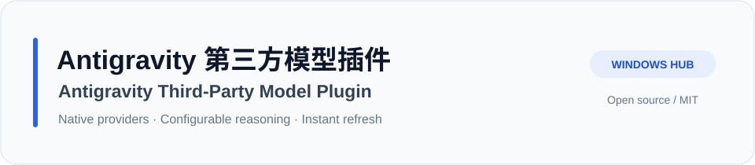

# v1.0.0 · Antigravity 第三方模型插件

**Antigravity Third-Party Model Plugin · Windows x64**

正式版本统一从 **1.0.0** 开始编号，整合前期开发中的功能与修复；已有提供商配置继续沿用。

## 中文

- **原生接入**：设置中的模型提供商入口，支持 OpenAI 兼容 Chat Completions、Anthropic Messages 和 Gemini。
- **先选再加**：拉取模型后在二级窗口搜索、勾选，只添加确认的模型。
- **思考强度多选**：聊天原生二级菜单按模型设置显示；支持上下文窗口、最大输出与配置来源查询。
- **保存即刷新**：普通模型变更无需重启，保留当前聊天与输入框。
- **流式兼容**：识别可读思考字段，兼容 JSON 完整回复，在 `[DONE]` 及时结束；工具参数完整并正常终止后才执行。
- **认证隔离**：第三方 401/403 显示为提供商服务错误，保留原始原因，不再误触发 Google 重新登录；真实 Google 认证错误保持原样。
- **实际状态**：聊天输入区显示等待上游、正文/思考接收与工具参数进度，不填充虚构内容。
- **一键安装与回滚**：固定官方 Node.js 下载并校验 SHA-256，保留本机配置，提供回滚入口。

### 下载与安装

1. 下载本页附件 **`antigravity-third-party-model-plugin-v1.0.0-windows-x64.zip`** 与 **`SHA256SUMS.txt`**，核对校验值后完整解压。
2. 双击 **`install-oneclick.cmd`**。首次安装或升级原生页面后，从托盘完全退出并重新打开 Antigravity 一次。
3. 进入 **设置 → 模型提供商**，填写自己的地址与密钥；获取模型、勾选、配置、保存。
4. 从前期开发版升级时沿用原安装目录，安装后运行该目录的 **`restart-bridge.cmd`**，再重新打开应用一次；无需重新填写提供商配置。

[完整教程](../QUICKSTART.md) · [中英文介绍与配图](../../README.md) · [问题排查](../TROUBLESHOOTING.md)

### 验证范围与限制

共 **276 项本地检查**（81 项单元/HTTP/界面及发行兼容、156 项协议、39 项新配置），另有安装、升级、配置保留及字节级回滚的隔离检查。原生 401/403 夹具验证不再误报登录过期。

支持范围为 **Windows x64 · Antigravity Hub 2.31.2**，需正常 Google 登录和有权使用的提供商 API。一次真实原生短回复约 11 秒完成；长任务仍可能受上游缓冲或超时影响，不能保证首字速度。默认首响应期限 180 秒、流空闲期限 120 秒。远程 CI 当前未启用。

## English

Official versioning starts at **1.0.0**, consolidating earlier development builds and preserving existing provider configuration.

- Embedded provider settings for OpenAI-compatible Chat Completions, Anthropic Messages and Gemini.
- Model discovery opens a selection dialog; it never imports every model automatically.
- Per-model reasoning checkboxes drive the native chat submenu, with configurable context/output limits and capability discovery.
- Saved model changes refresh without restarting the application.
- Streaming supports readable reasoning aliases, JSON/full-message replies and prompt `[DONE]` termination. Tool calls require complete arguments and a terminal response.
- Provider HTTP 401/403 errors stay separate from Google authentication, preserving the original provider error details.
- Inline native transport progress reports actual phases and counts.
- One-click installation with a verified official Node.js runtime, existing-configuration preservation and rollback.

Download the **Windows ZIP** and **SHA256SUMS.txt** below, verify/extract, then run **`install-oneclick.cmd`**. Fully quit/reopen Antigravity once after installation or a native-page upgrade. When upgrading an earlier development build, reuse its install directory and run that directory's **`restart-bridge.cmd`** before reopening the application. Add your own provider under **Settings → 模型提供商**.

Validation: **276 local checks** plus isolated install/upgrade/configuration-preservation/byte-exact rollback checks. Tested application: **Antigravity Hub 2.31.2 on Windows x64**. A working Google login and authorized provider API access are required. Real upstream first-byte latency remains provider-dependent; short-reply success does not establish long-task performance. Remote CI is not enabled.

[English guide](../README.en.md) · [Security and privacy](../../SECURITY.md) · [License](../../LICENSE)
